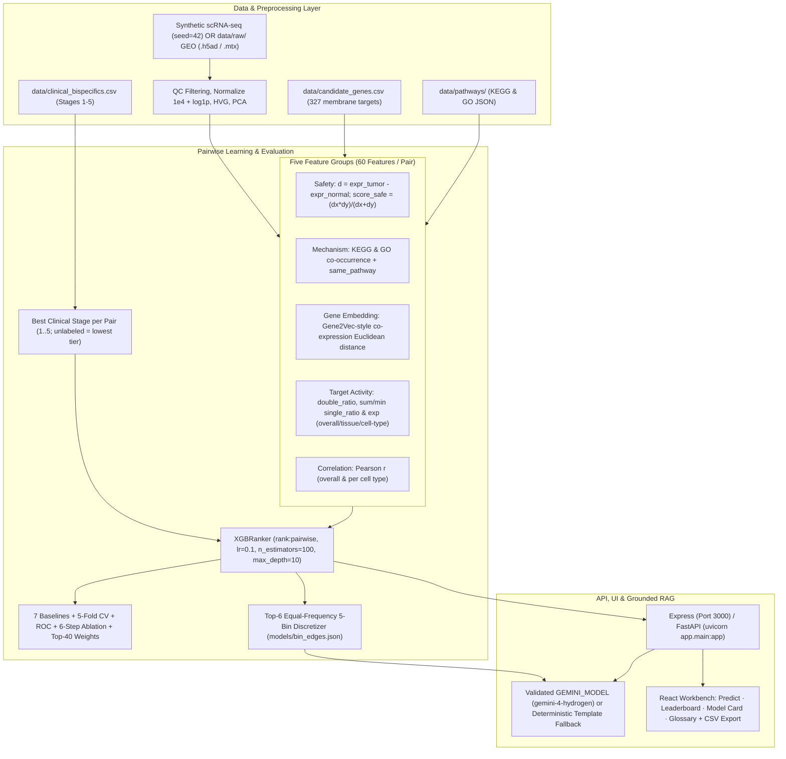

# BiSpec Pairwise AI (BSPAI)

A research prototype reimplementing **"BiSpec Pairwise AI: guiding the selection of bispecific antibody target combinations with pairwise learning and GPT augmentation"** (Zhang, Wang, Sun; *J Cancer Res Clin Oncol* 2024, 150:237).

BSPAI predicts target-pair druggability across all $G(G-1)/2$ candidate membrane-protein combinations, exposes quantitative single-cell and pathway features, benchmarks pairwise XGBoost against seven baselines under 5-fold cross-validation, and generates provenance-stamped, retrieval-augmented analytical reports.

---

## Architecture



---

## Quickstart

### 1. Live Web Workbench (Node.js / Express + React + TypeScript Engine)

```bash
npm install
npx tsx scripts/run_all.ts
npm run dev
```

Open `http://localhost:3000` to use the **Predict**, **Leaderboard**, **Model Card**, and **Glossary** views.

### 2. Local Python 3.11 Pipeline & FastAPI Server

```bash
pip install -r requirements.txt
python scripts/run_all.py
uvicorn app.main:app --reload
```

### Environment Variables

Copy `.env.example` to `.env`:

- `GEMINI_API_KEY`: Optional server-side Gemini API key. If omitted, BSPAI automatically falls back to a deterministic template report so the workflow never breaks.
- `GEMINI_MODEL`: Validated Gemini model ID (`gemini-4-hydrogen`, `gemini-4-argon`, `gemini-4-carbon`, or `gemini-3.1-flash-lite`). Deprecated models such as `gemini-1.5-*` or `gemini-2.0-*` are rejected at startup.
- `BSPAI_SEED`: Deterministic seed (default `42`) shared across TypeScript and Python.
- `BSPAI_ENABLE_WEB_SEARCH`: Set `true` to enable Google Search grounding during Gemini synthesis.

---

## Plugging In Real GEO Single-Cell Data

BSPAI supports real GEO cohorts referenced in the paper:

- **GSE131907**: Non-small cell lung cancer (NSCLC — tumor lung, normal lung, lymph node, brain mets)
- **GSE205013**: Pancreatic ductal adenocarcinoma (PDAC)
- **GSE164690**: Head and neck squamous cell carcinoma (HNSCC)
- **GSE156625**: Hepatocellular carcinoma (liver)

To ingest real data in the Python pipeline:

1. Place either a processed `.h5ad` file (with `obs['tissue']` and `obs['cell_type']`) or a 10x Genomics directory (`matrix.mtx[.gz]`, `features.tsv`, `barcodes.tsv`, and `metadata.csv`) inside `data/raw/`.
2. Run `python scripts/run_all.py`.
3. `bspai/data.py:load_geo_dataset` automatically detects `data/raw/`, applies stratified per-cell-type subsampling (`max_cells_per_type=500` by default) so large atlases fit in laptop RAM, subsets to the curated target gene panel, and runs Scanpy QC, normalization, HVG selection, PCA, and neighbor clustering (`bspai/preprocess.py`).

---

## Verification & Parity Tests

- **Python unit & GEO ingestion tests**:
  ```bash
  python3 -m unittest tests/test_formulas.py tests/test_geo_loader.py -v
  ```
- **TypeScript formula, ranking, API smoke & TS-vs-Python parity tests**:
  ```bash
  npm test
  ```
  `tests/ts/parity.test.ts` executes both the TypeScript and Python feature engines under shared `seed=42` and asserts that all 60 engineered features match within `1e-5`.
- **FastAPI smoke tests** (when Python dependencies are installed):
  ```bash
  pytest tests/test_api_smoke.py
  ```

---

## Domain Glossary

- **Bispecific antibody**: An engineered antibody molecule with two distinct binding arms that simultaneously recognize two different antigens or epitopes.
- **Antigen / target**: A specific cell-surface or extracellular protein molecule recognized and bound by a therapeutic antibody.
- **scRNA-seq**: Single-cell RNA sequencing, a high-resolution assay measuring gene expression levels inside individual cells rather than bulk tissue averages.
- **Tumor microenvironment**: The heterogeneous ecosystem surrounding malignant cells, including infiltrating immune cells, fibroblasts, blood vessels, and signaling molecules.
- **TAA**: Tumor-associated antigen, a protein expressed at substantially higher levels on cancer cells than on healthy normal tissues.
- **Immune checkpoint**: A regulatory receptor-ligand pathway (such as PD-1/PD-L1 or CTLA-4) that normally dampens immune responses and is co-opted by tumors to evade killing.
- **T cell**: A white blood cell (lymphocyte) responsible for recognizing and destroying infected or cancerous cells when properly activated.
- **KEGG**: Kyoto Encyclopedia of Genes and Genomes, a curated database mapping genes into known molecular signaling and metabolic pathways.
- **GO**: Gene Ontology, a standardized vocabulary describing gene functions across biological processes, cellular locations, and molecular activities.
- **Clinical phase**: The staged human testing milestones (Phase 1 safety, Phase 2 efficacy, Phase 3 large confirmatory trials, and regulatory approval) required before a drug is marketed.
- **AUC**: Area Under the ROC Curve, a threshold-independent metric from 0.5 to 1.0 measuring how well a model ranks positive examples above negative ones.

---

## Limitations & Research Disclaimer

- **Demo Synthetic Mode**: Out of the box, the prototype uses a deterministic synthetic NSCLC-like scRNA-seq cohort (`SYNTHETIC_NSCLC_GSE131907_LIKE_V1`, clearly marked `DEMO DATA` in the UI) rather than primary patient sequencing reads.
- **Small Labeled Positive Set**: Clinical bispecific training labels cover 50+ curated pairs across Stages 1–5; 5-fold cross-validation variance reflects this small sample size.
- **Reconstructed Supplementary Tables**: Because the original Zhang et al. (2024) supplementary gene/clinical tables were not bundled, the curated 327-gene catalog, KEGG/GO subsets, and clinical benchmark table were reconstructed independently and annotated with `needs_verification` flags.
- **Not Clinical Advice**: All scores, rankings, and RAG reports are computational research aids and must be validated experimentally.
